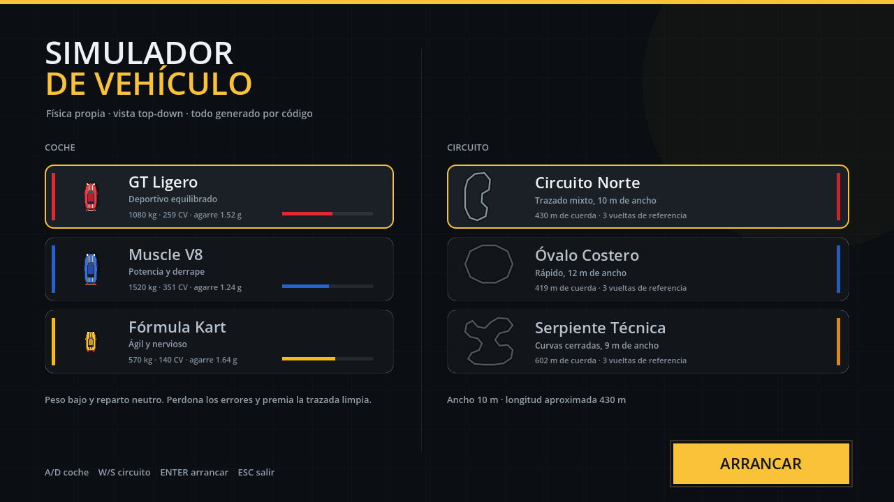

# CarSpot Driving Simulator

CarSpot es un proyecto personal de simulación y juegos de conducción. La idea es
construirlo en tres etapas: conservar y mejorar el simulador académico original,
crear una experiencia de carreras 2D y, más adelante, desarrollar un juego 3D.
Cada etapa permite explorar una forma distinta de modelar y presentar la
conducción.

## Los tres juegos

| Versión | Carpeta | Tecnología | Estado |
| --- | --- | --- | --- |
| **1. Simulador de Vehículo** | [`simuladorDeVehiculo/`](simuladorDeVehiculo/) | Java, Swing y Ant | Prototipo académico existente; necesita bastante trabajo para convertirse en un juego completo. |
| **2. CarSpot 2D** | [`game2d/`](game2d/) | Godot 4.7, GDScript | Jugable; carreras top-down con varios coches y circuitos. |
| **3. CarSpot 3D** | Por definir | Por definir | Idea futura; aún sin implementación ni decisiones técnicas. |

Las versiones forman parte de una misma evolución del proyecto, pero cada una
tiene su propio código y forma de ejecución. La versión Java se conserva como
primera etapa y referencia; el desarrollo activo del juego está en `game2d/`.

## Empezar con CarSpot 2D

Instala [Godot 4.7](https://godotengine.org/) y ejecuta desde la raíz del repo:

```bash
godot --path game2d
```

El menú permite seleccionar coche y circuito. En carrera, `W`/`↑` acelera,
`S`/`↓` frena, `A`/`D` dirige, `Espacio` usa el freno de mano, `R` recoloca el
coche, `C` cambia la cámara, `G` muestra el fantasma, `L` muestra la trazada,
`M` vuelve al menú y `ESC` pausa.

CarSpot 2D incluye física vehicular propia, tres coches y tres circuitos,
cronometraje por sectores, fantasma de la mejor vuelta, marcas de derrape, humo,
cámara dinámica y audio de motor sintetizado. Los detalles de arquitectura,
controles, pruebas y cómo añadir coches o circuitos están en el
[README de `game2d/`](game2d/README.md).

| Menú | Carrera |
| --- | --- |
|  |  |

## Versión 1: Simulador de Vehículo

La primera versión es un proyecto académico de programación orientada a
objetos. Modela un carro con componentes intercambiables —motores y llantas—,
maneja estados y excepciones propias, lee la configuración desde
`simuladorDeVehiculo/data/especificaciones.txt` y presenta una cabina con
Java Swing. También incluye imágenes y sonidos propios. La refactorización
inicial ya permite perfiles seleccionables, interiores clásico/deportivo,
velocímetro, tacómetro y transmisiones manuales o automáticas.

Es una base funcional para experimentar, pero todavía requiere bastante trabajo
en diseño, arquitectura, experiencia de usuario y alcance para sentirse como
un juego completo. Su código se mantiene separado de Godot.

### Ejecutar

Se necesita un JDK compatible con Java 22. La manera más directa es abrir
`simuladorDeVehiculo/` como proyecto Ant en NetBeans y ejecutar
`autonoma.main.Main`. El archivo de configuración se carga desde una ruta
relativa (`data/especificaciones.txt`), así que ejecuta el programa con
`simuladorDeVehiculo/` como directorio de trabajo.

La clase de entrada está en
[`Main.java`](simuladorDeVehiculo/src/autonoma/main/Main.java); las instrucciones
de proyecto de NetBeans están en `simuladorDeVehiculo/nbproject/`. Consulta el
[README de la versión Java](simuladorDeVehiculo/README.md) para crear perfiles,
entender los controles y conocer la arquitectura.

## Versión 3: juego 3D

La meta a largo plazo es crear una tercera experiencia de conducción en 3D. Aún
no están definidos el motor, el estilo visual, las plataformas ni las funciones;
esas decisiones se tomarán cuando la etapa 2D y las prioridades del proyecto
den una base más clara.

## Estructura del repositorio

```text
CarSpot-driving-simulator/
├── simuladorDeVehiculo/   # Versión 1: Java + Swing (prototipo académico)
├── game2d/                # Versión 2: juego de carreras en Godot
├── README.md              # Presentación general y hoja de ruta
└── AGENTS.md              # Guía de trabajo del repositorio
```

La versión 3D se añadirá como una carpeta propia cuando comience su desarrollo.

## Desarrollo

Para ejecutar la prueba rápida del juego 2D:

```bash
godot --headless --path game2d -- --smoke
```

Para simular vueltas durante 45 segundos:

```bash
godot --headless --path game2d -- --laps --time=45
```

Más opciones de prueba y capturas están documentadas en
[`game2d/README.md`](game2d/README.md).

## Dirección del proyecto

1. **Mejorar la versión 1**: revisar el simulador Java original y decidir qué
   partes conservar, actualizar o rediseñar.
2. **Desarrollar la versión 2**: ampliar y pulir el juego 2D de Godot.
3. **Planear la versión 3**: definir alcance y tecnología para una experiencia
   de conducción 3D.

El orden expresa la evolución deseada, no una promesa de fechas. El foco actual
está en la versión 2D, mientras la primera permanece disponible como punto de
partida para mejoras futuras.
