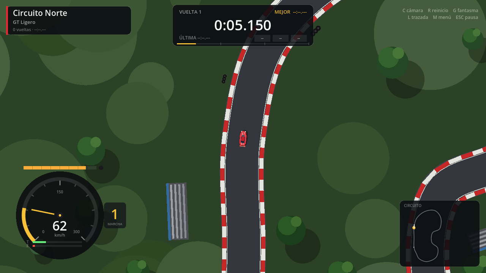

# CarSpot Driving Simulator

Dos etapas del mismo proyecto:

| Carpeta | Qué es | Estado |
| --- | --- | --- |
| [`game2d/`](game2d/) | Juego de carreras top-down en Godot 4 con física de vehículo propia, pistas y coches generados por código | Jugable |
| [`simuladorDeVehiculo/`](simuladorDeVehiculo/) | Simulador académico original en Java + Swing (motor, llantas, sonidos, persistencia) | Legado |

## Empezar

```bash
brew install --cask godot
godot --path game2d
```

`ENTER` arranca la carrera, `M` vuelve al menú y `ESC` pausa.

Controles, física, arquitectura y pruebas automáticas:
[`game2d/README.md`](game2d/README.md).

| Menú | Carrera |
| --- | --- |
|  |  |

## El proyecto original (Java)

Ejercicio de POO de hace dos semestres: herencia de `Motor` y `Llanta`,
excepciones propias, lectura de configuración desde `data/especificaciones.txt`
y una cabina en Swing con pedales y audio. Se conserva como referencia y para
reutilizar assets (imágenes del volante y los pedales, sonidos).

Abrir con NetBeans o IntelliJ; el `main` está en
`simuladorDeVehiculo/src/autonoma/main/Main.java`.
