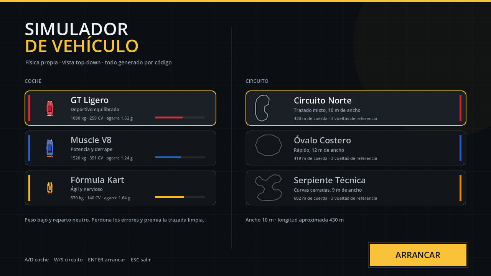
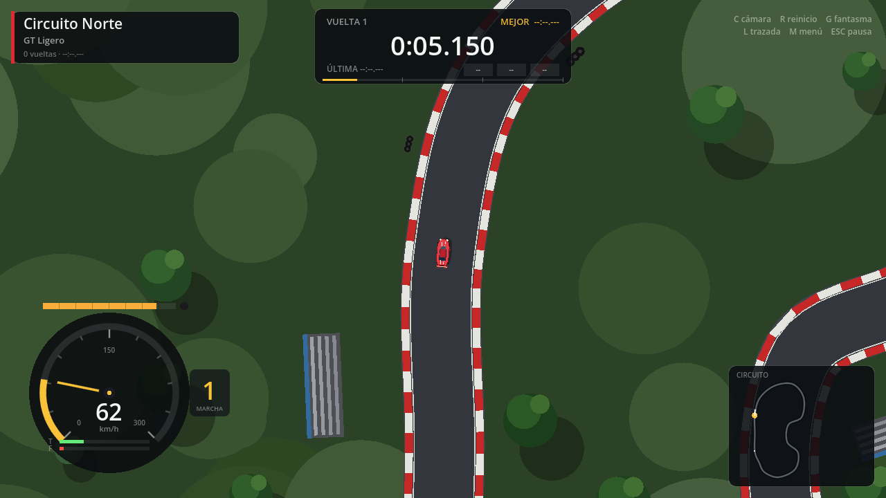

# Simulador de Vehículo 2D

Juego de carreras **top-down** con física de vehículo propia, hecho entero por
código en Godot 4: no hay modelos, texturas ni escenas de arte. Las pistas, los
coches, el tablero, el menú y los efectos se dibujan y se generan en tiempo de
ejecución.

| Menú | Carrera |
| --- | --- |
|  |  |

## Empezar

```bash
brew install --cask godot
godot --path game2d
```

`ENTER` arranca la carrera, `ESC` pausa, `M` vuelve al menú.

## Controles

| Tecla | Acción |
| --- | --- |
| `W` / `↑` | Acelerador |
| `S` / `↓` | Freno y marcha atrás |
| `A` `D` / `←` `→` | Volante |
| `Espacio` | Freno de mano |
| `R` | Volver a la pista |
| `C` | Cámara con o sin rotación |
| `G` | Mostrar u ocultar el fantasma |
| `L` | Trazada de referencia |
| `M` | Menú |
| `ESC` / `P` | Pausa |

En el menú: `A`/`D` elige coche, `W`/`S` elige circuito, `ENTER` arranca y
`ESC` sale.

## Qué incluye

- **Tres circuitos**: Circuito Norte (mixto, 416 m), Óvalo Costero (rápido,
  405 m) y Serpiente Técnica (cerradas, 585 m). En los tres la línea de meta
  cae sobre una recta para que el cronómetro no se tome torcido.
- **Tres coches**: GT Ligero (equilibrado), Muscle V8 (par y sobreviraje) y
  Fórmula Kart (ligero y nervioso). Cambian masa, reparto, agarre, frenos,
  curva de par, relaciones de caja y dibujo.
- **Física propia**: modelo de bicicleta dinámica con ángulos de deslizamiento,
  círculo de fricción, carga aerodinámica, resistencia, pérdida de agarre en
  césped y freno de mano.
- **Cronometraje**: vuelta actual, mejor, última, tres sectores con delta
  contra la mejor vuelta y barra de progreso.
- **Fantasma**: se graba la mejor vuelta y se reproduce como silueta.
- **Marcas de derrape persistentes** y humo de neumático.
- **Cámara dinámica**: sigue al coche, rota con el rumbo, aleja al acelerar y
  vibra fuera de pista.
- **Audio sintetizado**: el motor se genera con un `AudioStreamGenerator`
  atado al régimen real y al deslizamiento.
- **Piloto automático** para pruebas y capturas.

## Arquitectura

Todo vive en `scripts/` y se conecta desde `main.gd`:

| Archivo | Responsabilidad |
| --- | --- |
| `main.gd` | Flujo de juego, cámara, cronometraje, fantasma, audio, autopiloto y modos de prueba |
| `car.gd` | Integración de la física del vehículo (bicicleta dinámica) |
| `car_specs.gd` | Datos de los tres coches |
| `powertrain.gd` | Motor y caja automática: par, marchas, embrague y freno de motor |
| `race_track.gd` | Catmull-Rom, geometría, consultas de física y dibujo de la pista |
| `track_data.gd` | Puntos de control y tema de los tres circuitos |
| `car_art.gd` | Dibujo top-down del coche (compartido con el fantasma) |
| `hud.gd` | Tablero, tacómetro, minimapa, avisos y pausa |
| `menu.gd` | Selección de coche y circuito |
| `skid_marks.gd` | Marcas de derrape persistentes |
| `ghost_car.gd` | Silueta de la mejor vuelta |
| `engine_audio.gd` | Motor de audio sintetizado en tiempo real |

La separación es deliberada: `track_data.gd` y `car_specs.gd` son **datos**,
`powertrain.gd` es **lógica pura sin nodos** y `car.gd` es la **simulación**.
Añadir un coche o una pista no requiere tocar la física.

### Física

Cada paso de física (120 Hz) se divide en 4 subpasos. En cada uno:

1. Se proyectan la velocidad y el rumbo en el eje del coche.
2. Se calculan los ángulos de deslizamiento delantero y trasero.
3. La fuerza lateral de cada eje se satura con la carga vertical y el círculo
   de fricción (lo que se usa para acelerar o frenar no agarra de lado).
4. Se integran las ecuaciones del modelo de bicicleta.
5. A menos de ~3 m/s se mezcla con la cinemática pura, para que el coche pueda
   maniobrar despacio sin volverse inestable.

El reparto de pesos, el downforce y el control de tracción suave hacen que el
coche sea estable al límite y que el sobreviraje aparezca con el gas y el freno
de mano, no en cada curva. El césped baja el agarre y multiplica el arrastre.

## Pruebas automáticas

Los argumentos van después de `--`:

```bash
godot --headless --path game2d -- --smoke              # 20 s de autopiloto
godot --headless --path game2d -- --laps               # 150 s de autopiloto
godot --headless --path game2d -- --laps --time=75     # duración a medida
godot --headless --path game2d -- --car=1 --track=2    # elegir coche y pista
godot --path game2d -- --shot                          # captura de carrera
godot --path game2d -- --menu_shot                     # captura del menú
```

Cada segundo imprimen velocidad, régimen, marcha, sectores, vueltas, mejor
tiempo y si el coche está dentro de la pista, y al terminar resumen vueltas,
mejor vuelta, velocidad máxima y segundos fuera de pista. Las capturas se
guardan en `/tmp/simulador2d_shot.png` y `/tmp/simulador2d_menu.png`.

## Añadir contenido

- **Circuito**: agrega un diccionario a `TRACKS` en `track_data.gd` con
  `name`, `width`, `points` (Vector2 en metros) y `theme`. La malla, los pianos,
  la meta, el césped y los adornos se generan solos.
- **Coche**: agrega un diccionario a `CARS` en `car_specs.gd`. La simulación, el
  HUD y el dibujo leen de esas claves.

Si añades un script con `class_name`, ejecuta una vez
`godot --headless --path game2d --editor --quit` para regenerar la caché de
clases globales.
